# 자바웹프로그래밍 | 2~10주차 실습 기록

**성결대학교 미디어소프트웨어학과 · 20230968 기경민**

개인 포트폴리오에서 MySQL 연동, 로그인·권한 관리, REST API, 게시판과 페이징·검색·댓글까지 확장한 Spring Boot 프로젝트입니다. 주차별 구현 내용, 연습문제와 실제 실행 화면을 한 페이지에 정리했습니다.

[2주차](#week-02) · [3주차](#week-03) · [4주차](#week-04) · [5주차](#week-05) · [6주차](#week-06) · [7주차](#week-07) · [9주차](#week-09) · [10주차](#week-10) · [실행 방법](#run)

| 개발 환경 | 구성 |
| --- | --- |
| 서버 | Java 26 · Spring Boot 4.1.1 · Maven |
| 화면 | Thymeleaf · Bootstrap 5 · Bootstrap Icons · JavaScript fetch |
| 데이터·보안 | MySQL `spring` · Spring Data JPA · Spring Security · BCrypt |
| 테스트 | JUnit · MockMvc · H2 |

> 2~7주차 화면은 **2026-10-24**, 9주차는 **2026-11-04**, 10주차는 **2026-11-12** 프로젝트를 실행하여 캡처했습니다. 관리자 화면은 기존 `admin` 계정, 회원 검색은 기경민(`rlrudals13`) 데이터를 사용했습니다. 이미지를 클릭하면 원본 크기로 볼 수 있습니다.

<a id="week-02"></a>
## 2주차 | 개발 환경 설정과 기본 테스트

Spring Boot 프로젝트를 실행하고 Controller에서 URL을 연결했습니다. Thymeleaf로 서버 데이터를 화면에 출력하며 요청 → Controller → Model → View 흐름을 확인했습니다.

**연습문제:** `/hello2`에 이름, 학번, 과목, 주차와 메시지를 전달했습니다. 주요 파일: `DemoController.java`, `hello.html`, `hello2.html`.

[](docs/images/weeks/week02-hello2.png)

<a id="week-03"></a>
## 3주차 | 나만의 포트폴리오

템플릿을 개인 포트폴리오로 수정했습니다. 프로필 사진·크기를 조정하고 자기소개와 일대기, 연락 영역, 웹·AI·보안·게임 분야의 상세 페이지와 가격을 구성했습니다.

| 메인 포트폴리오 | 자기소개·일대기 |
| --- | --- |
| [](docs/images/weeks/week03-portfolio.png) | [](docs/images/weeks/week03-about.png) |

<details>
<summary>게임 상세 페이지 보기</summary>

[](docs/images/weeks/week03-game.png)

상세 주소: `/detailed_web.html`, `/detailed_ai.html`, `/detailed_security.html`, `/detailed_game.html`.

</details>

<a id="week-04"></a>
## 4주차 | MySQL 데이터베이스 연동

MySQL의 `spring` DB에 연결하고 Entity → Repository → Service → Controller 구조를 구성했습니다. `/testdb`에서 이름 검색 결과, 전체 데이터 수와 회원 목록을 출력합니다.

**확인:** 실제 DB에서 홍길동 검색 결과와 샘플 데이터 3건을 조회했습니다. 주요 파일: `TestDB.java`, `TestRepository.java`, `TestService.java`, `testdb.html`.

[](docs/images/weeks/week04-database.png)

<a id="week-05"></a>
## 5주차 | 회원가입·로그인·로그아웃

Spring Security로 회원가입, 세션 로그인·로그아웃과 로그인 상태 유지(remember-me)를 구현했습니다. 회원가입 시 빈 값, 중복 아이디, 비밀번호 확인을 검사하고 비밀번호는 BCrypt 해시로 저장합니다.

| 로그인 · 상태 유지 | 회원가입 · 입력 검증 |
| --- | --- |
| [](docs/images/weeks/week05-login.png) | [](docs/images/weeks/week05-signup.png) |

<a id="week-06"></a>
## 6주차 | 권한 관리와 관리자 페이지

USER·MANAGER·ADMIN으로 권한을 구분하고 관리자 회원 목록, 권한 변경·삭제, 내 정보와 403 화면을 구현했습니다. URL 접근 제어와 서비스의 `@PreAuthorize`를 함께 적용했습니다.

**연습문제:** 관리자의 본인 권한 변경·삭제를 차단하고, `/testdb`는 ADMIN·MANAGER만 접근하도록 설정했습니다. 캡처에서는 기존 `admin`의 본인 권한 변경이 차단되어 실제 권한이 ADMIN으로 유지되는 것을 확인했습니다.

| 실제 회원 목록 · 권한 관리 | 관리자 본인 권한 변경 차단 |
| --- | --- |
| [](docs/images/weeks/week06-admin.png) | [](docs/images/weeks/week06-self-protection.png) |

<details>
<summary>기존 계정의 내 정보 보기</summary>

[](docs/images/weeks/week05-mypage.png)

</details>

<a id="week-07"></a>
## 7주차 | REST API와 JSON

회원 조회·등록·권한 변경·삭제를 JSON API로 구현하고 제공 코드의 fetch 화면을 연결했습니다. `MemberResponse`로 비밀번호·해시를 응답에서 제외하고 브라우저 세션 인증과 Postman Basic 인증을 지원합니다.

**연습①:** 아이디 또는 이름에 검색어가 포함된 회원 검색. 공백·영문 대소문자를 처리하며 검색어가 없으면 전체 목록을 반환합니다. 실제 이름인 ‘기경민’으로 검색하여 `rlrudals13` 회원을 확인했습니다.

**연습②:** `@RestControllerAdvice`로 오류 처리를 통합하고 잘못된 요청은 `400 + {"error":"메시지"}`로 반환합니다.

| 회원 검색 · 200 JSON 응답 | 필수 값 누락 · 400 오류 응답 |
| --- | --- |
| [](docs/images/weeks/week07-api-search.png) | [](docs/images/weeks/week07-api-error.png) |

<details>
<summary>REST API 주소와 테스트 방법 보기</summary>

| 메서드 | 주소 | 접근 / 응답 |
| --- | --- | --- |
| GET | `/api/hello` | 공개 / 200, 인사·시간 |
| GET | `/api/me` | 로그인 회원 / 200, 내 정보 |
| GET | `/api/admin/members?keyword=기경민` | ADMIN / 200, 목록·검색 |
| GET | `/api/admin/members/{id}` | ADMIN / 200, 없으면 404 |
| POST | `/api/admin/members` | ADMIN / 201 + Location 헤더 |
| PATCH | `/api/admin/members/{id}/role` | ADMIN / 200, 변경된 회원 |
| DELETE | `/api/admin/members/{id}` | ADMIN / 204, 본문 없음 |

등록 JSON은 `username`, `password`, `passwordConfirm`, `name`입니다. 신규 회원은 요청에 `role`을 추가해도 USER로 저장하며, 권한 변경은 `{"role":"MANAGER"}` 형식입니다. 응답에는 `id`, `username`, `name`, `role`만 포함합니다.

Postman은 **Authorization → Basic Auth**에 실제 가입한 계정을 입력하고 **Body → raw → JSON**으로 요청합니다. 미인증 API는 401, 관리자 권한 부족은 403을 반환합니다. 실습 조건에 따라 `/api/**`만 CSRF 검사에서 제외하며 HTML 폼은 검사를 유지합니다. Basic 인증의 외부 서비스 사용에는 HTTPS가 필요합니다.

```bash
curl http://localhost:8080/api/hello
curl -u admin 'http://localhost:8080/api/admin/members?keyword=student'
```

두 번째 명령은 관리자 비밀번호를 별도로 입력받습니다.

</details>

<a id="week-09"></a>
## 9주차 | 게시판 CRUD와 본인 확인

제공된 게시판 화면을 연결하고 글 작성·목록·상세·수정·삭제를 구현했습니다. `posts.member_id`는 `@ManyToOne`으로 회원과 연결하며, 작성자는 입력값이 아니라 로그인한 계정으로 저장합니다. 제목·내용의 빈 값과 제목 100자 제한을 서버에서 검사하고, 잘못 입력하면 내용을 유지한 채 오류를 표시합니다.

수정은 **작성자 본인만**, 삭제는 **작성자 또는 ADMIN**만 가능합니다. 화면에서 버튼을 구분하고 서비스에서도 작성자를 검사하기 때문에 주소를 직접 입력하거나 요청을 보내도 남의 글을 수정할 수 없습니다. 관리자도 다른 사람의 글은 수정할 수 없습니다. 없는 게시글은 404 안내 화면을 표시합니다.

**연습① 조회수:** 상세 화면을 열 때마다 1 증가하며 목록·수정 화면을 열 때는 늘지 않습니다. DB에서 증가 연산을 수행하여 동시 조회 시 증가분 유실을 방지했습니다.

**연습② 내가 쓴 글:** `/board/my`에서 로그인한 회원의 글만 최신순으로 보여줍니다. 목록 화면을 재사용하고 제목을 ‘내가 쓴 글’로 변경했습니다.

| 게시글 목록 | 상세 화면 · 조회수 3회 |
| --- | --- |
| [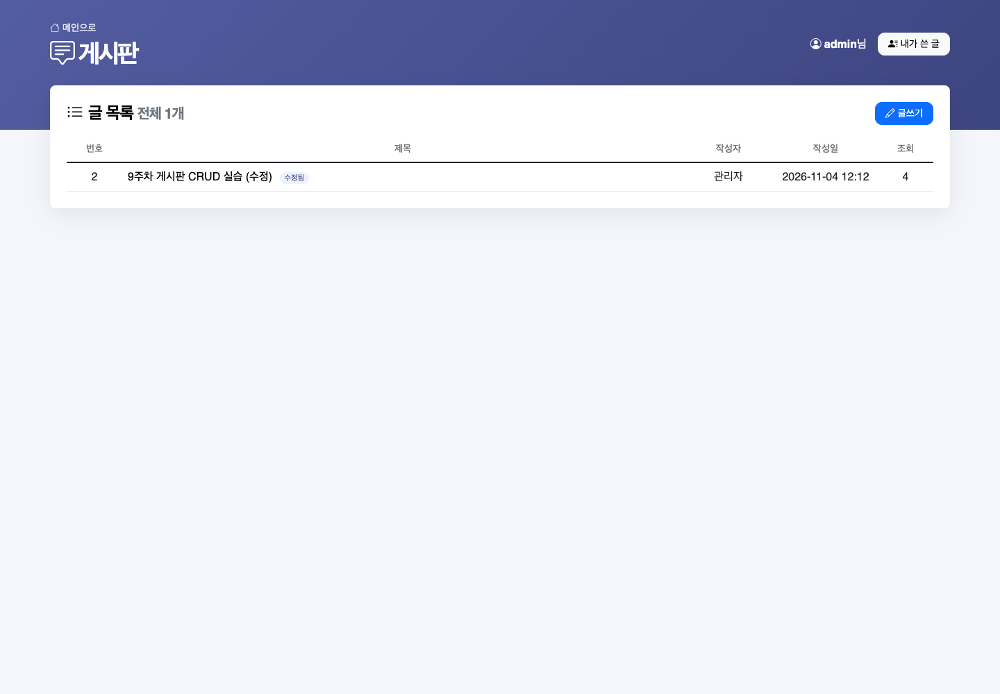](docs/images/weeks/week09-list.png) | [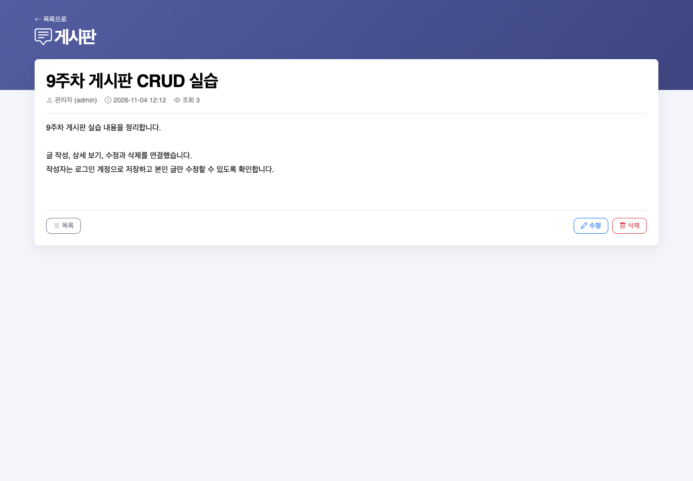](docs/images/weeks/week09-detail.png) |

<details>
<summary>내가 쓴 글·입력 오류·404·모바일 화면 보기</summary>

| 내가 쓴 글 | 제목 누락 검사 |
| --- | --- |
| [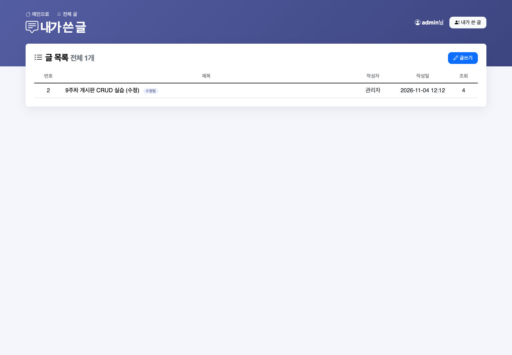](docs/images/weeks/week09-my-posts.png) | [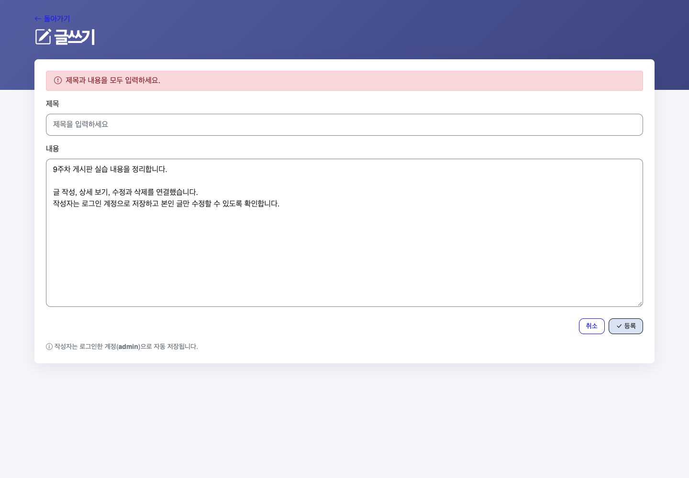](docs/images/weeks/week09-validation.png) |

| 없는 글 · 404 | 모바일 상세 |
| --- | --- |
| [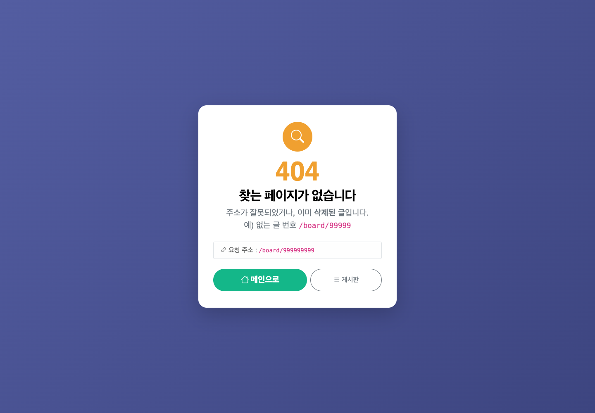](docs/images/weeks/week09-not-found.png) | [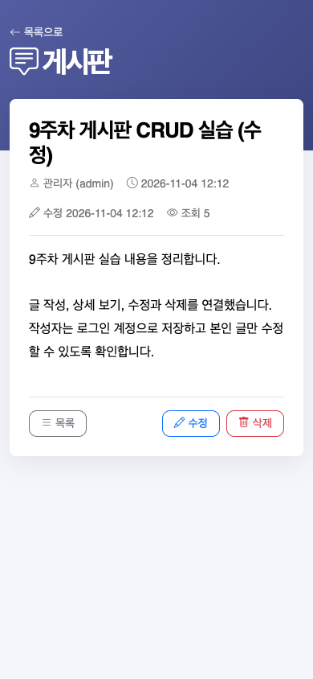](docs/images/weeks/week09-mobile.png) |

</details>

| 기능 | 주소 | 접근 규칙 |
| --- | --- | --- |
| 목록·상세 | `GET /board`, `GET /board/{id}` | 누구나 |
| 작성 | `GET·POST /board/write` | 로그인 회원 |
| 내 글 목록 | `GET /board/my` | 로그인 회원 |
| 수정 | `GET·POST /board/{id}/edit` | 작성자 본인 |
| 삭제 | `POST /board/{id}/delete` | 작성자 또는 ADMIN |

게시판은 HTML 폼 방식으로 구현하여 CSRF 검사를 유지합니다. 제목·본문은 `th:text`로 출력해 입력한 HTML이 실행되지 않게 했습니다. 글은 MySQL에 저장되며 Git에는 코드만 저장됩니다. 9주차에서 남겨 둔 회원 삭제와 게시글의 외래 키 처리는 아래 10주차에서 보완했습니다.

9주차 게시판 자동 테스트 9개를 추가하여 기존 테스트와 합쳐 **16개가 통과**했습니다. 비로그인 접근, 작성자 위조 방지, 남의 글 수정·삭제 차단, 관리자 삭제·수정 제한, 입력 검증, 조회수, 내 글 목록과 HTML 이스케이프를 확인했습니다. 캡처에 사용한 확인용 게시글은 검증 후 삭제했습니다.

<a id="week-10"></a>
## 10주차 | 페이징·검색·댓글

글이 많아져도 한 번에 전부 가져오지 않도록 `PageRequest`와 `Page`로 목록을 **10개씩 최신순**으로 나눴습니다. 주소의 `page`는 0부터 시작하고 화면에는 1부터 표시합니다. 음수 페이지는 첫 페이지로 처리하며 범위를 벗어나면 빈 목록과 첫 페이지 링크를 보여줍니다.

제목·내용 검색은 JPQL 파라미터 바인딩을 사용하고, 페이지를 이동해도 `keyword`와 `type`을 유지합니다. 댓글은 로그인한 계정으로 저장하며 1~500자를 검사합니다. 등록 후에는 상세 화면으로 redirect하여 새로고침 시 중복 등록을 방지했습니다. 댓글은 본인 또는 ADMIN만 삭제할 수 있고, 글 작성자라도 다른 사람의 댓글을 지울 수 없습니다.

**연습① 내가 쓴 글 페이징:** `/board/my?page=0`에서도 내 글만 10개씩 조회하며 페이지 링크가 `/board/my`를 유지합니다.

**연습② 작성자로 검색:** 검색 범위를 ‘작성자’로 선택하면 회원 이름으로 검색합니다. 다음 페이지에서도 `type=writer`와 검색어가 유지됩니다.

| 10개씩 나눈 게시판 · 11페이지 | 댓글 작성·삭제 |
| --- | --- |
| [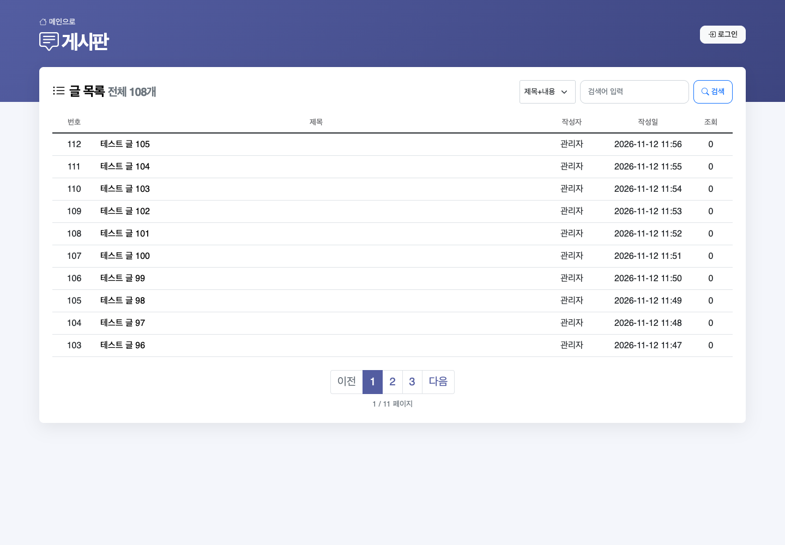](docs/images/weeks/week10-paging.png) | [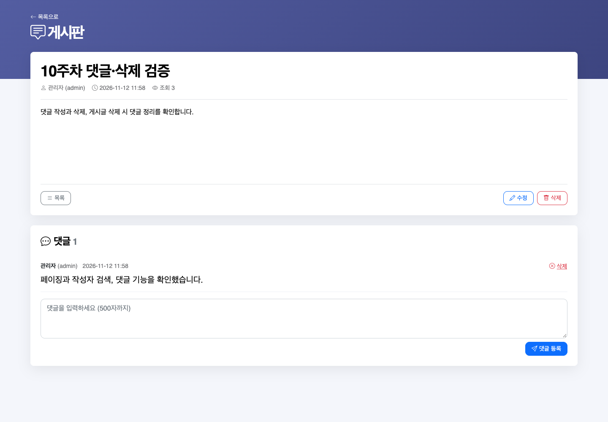](docs/images/weeks/week10-comments.png) |

<details>
<summary>검색·연습문제·모바일 화면과 DB 확인 방법 보기</summary>

| 검색 조건을 유지한 2페이지 | 작성자 검색 |
| --- | --- |
| [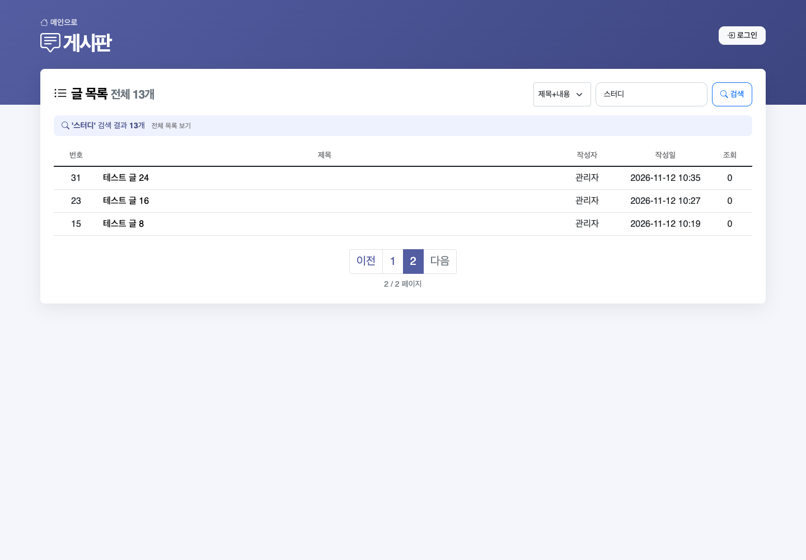](docs/images/weeks/week10-search.png) | [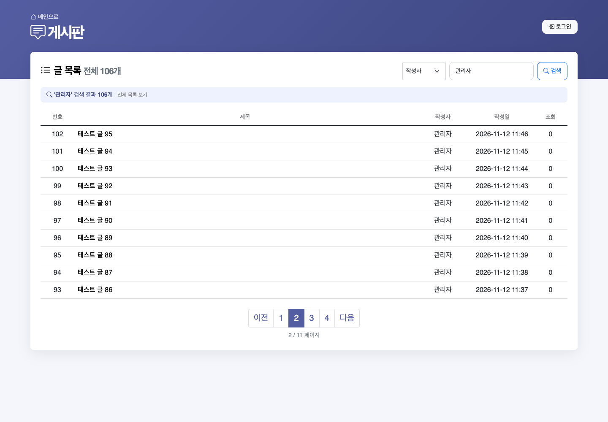](docs/images/weeks/week10-writer-search.png) |

| 내가 쓴 글 페이징 | 모바일 검색 화면 |
| --- | --- |
| [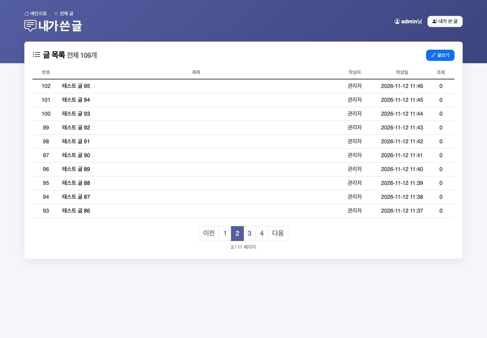](docs/images/weeks/week10-my-paging.png) | [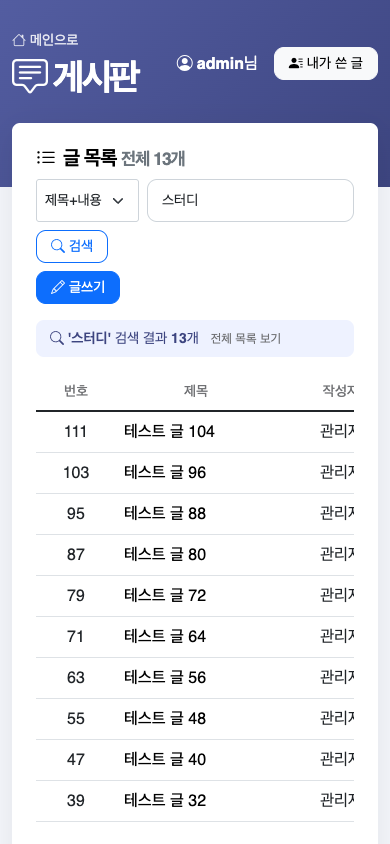](docs/images/weeks/week10-mobile.png) |

실습 자료의 테스트 글 105개를 기존 `admin` 계정으로 추가했습니다. 검증 시 기존 글을 포함해 총 108개, ‘스터디’ 검색은 13개였습니다. [실습 SQL](week10-test-posts.sql)은 재실행해도 같은 제목의 테스트 글을 중복으로 추가하지 않습니다.

VS Code의 DB 연결에서도 **`spring` 데이터베이스**를 선택하고 테이블 목록을 새로고침하면 됩니다. 실제 MySQL에서 `member`, `testdb`, `posts`, `comments` 테이블을 확인했습니다.

```sql
SHOW TABLES FROM spring;
DESCRIBE spring.posts;
DESCRIBE spring.comments;
```

</details>

**삭제 처리 보완:** 글을 삭제하면 `CascadeType.REMOVE`로 그 글의 댓글도 함께 삭제합니다. 글이나 댓글을 작성한 회원은 `existsByAuthor`로 먼저 확인하여 삭제를 막고, 관리자 화면에는 안내 메시지, API에는 400 오류를 반환합니다. 외래 키 오류로 500이 발생하던 부분을 보완했습니다.

기존 16개에 페이징·검색·댓글 테스트 9개를 추가해 **총 25개가 통과**했습니다. 검색어가 SQL로 실행되지 않는지, 댓글의 작성자·글 번호를 바꿔 요청해도 권한과 소속 검사가 적용되는지, 글 삭제 시 해당 댓글만 지워지는지도 확인했습니다. 실제 브라우저에서는 페이지 이동, 검색, 내 글, 댓글 등록·삭제·새로고침과 모바일 표시를 확인했습니다. 검증용 게시글과 댓글은 삭제하고, 제공 자료의 페이징 실습 글은 남겨 두었습니다.

<a id="run"></a>
## 실행 및 검증

프로젝트는 VS Code에서 실행했습니다. 먼저 MySQL이 실행 중인지 확인하고, 수업 자료에 맞춰 `spring` 데이터베이스를 사용하도록 설정했습니다. DB 접속 정보는 `src/main/resources/application-secret.properties`에 따로 작성하고 Git에 올라가지 않도록 제외했습니다.

```sql
CREATE DATABASE IF NOT EXISTS spring CHARACTER SET utf8mb4 COLLATE utf8mb4_unicode_ci;
```

VS Code 터미널에서 아래 명령으로 서버를 실행한 뒤, 브라우저에서 `http://localhost:8080/`에 접속해 화면을 확인했습니다.

```bash
./mvnw spring-boot:run
```

관리자 기능은 기존 `admin` 계정으로 로그인해서 확인했습니다. 관리자 계정을 처음 설정할 때는 회원가입 후 [관리자 권한 SQL](관리자_권한_부여.sql)을 실행하고, 로그아웃했다가 다시 로그인해야 변경된 권한이 적용됩니다.

| 기능 | 주소 | 접근 권한 |
| --- | --- | --- |
| 포트폴리오·기본 실습 | `/`, `/hello`, `/hello2` | 공개 |
| 회원가입·로그인 | `/signup`, `/login` | 공개 |
| 내 정보 | `/mypage` | 로그인 회원 |
| DB 조회 | `/testdb` | ADMIN·MANAGER |
| 관리자 화면 | `/admin/members`, `/admin/members-api` | ADMIN |
| 게시판 목록·상세 | `/board`, `/board/{id}` | 공개 |
| 글쓰기·내 글 | `/board/write`, `/board/my` | 로그인 회원 |

**실행하면서 확인한 내용**

로그인한 뒤 DB 조회 화면에서 데이터가 나오는지 확인했습니다. 관리자 화면에서는 실제 회원 목록과 권한을 확인하고, `admin` 자신의 권한을 변경하려고 했을 때 오류 메시지가 나오면서 기존 권한이 유지되는 것도 확인했습니다.

7주차 API 화면에서는 이름에 ‘기경민’을 입력해 제 계정인 `rlrudals13`이 검색되는지 확인했습니다. 검색 요청은 200으로 응답했고, 회원 등록 내용을 비워서 보내면 400과 함께 입력 오류 메시지가 나왔습니다. 화면 오른쪽의 요청·응답 기록을 보면서 결과를 확인할 수 있었습니다.

자동 테스트는 아래 명령으로 실행했으며, H2·MockMvc를 사용하는 테스트 7개가 통과했습니다.

```bash
./mvnw test
```

**실습 중 수정한 부분**

프로필 사진이 적용되지 않거나 크기가 맞지 않는 문제는 이미지 경로와 크기 설정을 수정했습니다. 회원가입 화면 오류는 HTML 속성의 따옴표 누락을 수정했고, DB 연결은 기존 설정을 확인해 수업에서 사용하는 `spring` DB에 맞췄습니다.

API에서는 로그인하지 않았을 때 로그인 화면 HTML 대신 401을 반환하도록 설정했습니다. 회원 엔티티를 그대로 반환하면 비밀번호 해시까지 나갈 수 있어서 응답 DTO에는 필요한 정보만 담았습니다. 이번 실습을 통해 화면이 정상적으로 보이는지뿐 아니라 권한과 응답 데이터, 상태 코드도 함께 확인해야 한다는 점을 정리할 수 있었습니다.
